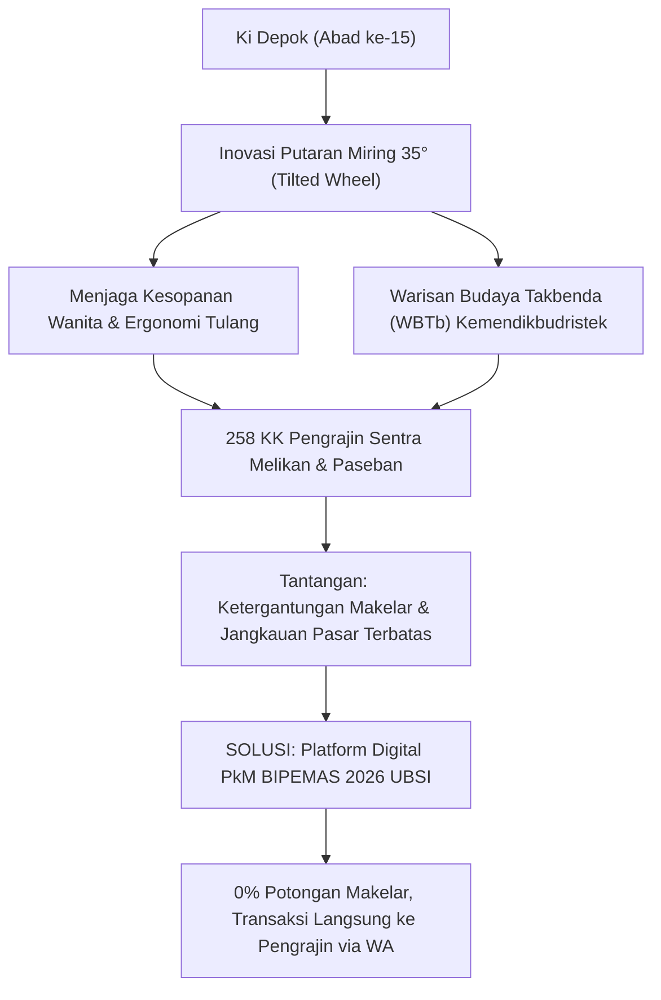
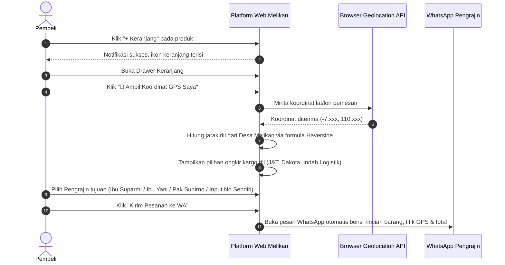

# BUKU PANDUAN PENGGUNAAN & PANDUAN PRESENTASI PLATFORM
## "Platform Digital Ekosistem Sentra Kriya Gerabah Tradisional Melikan & Paseban"
### Program Kemitraan Masyarakat (PkM) Hibah BIPEMAS 2026 — Universitas Bina Sarana Informatika (UBSI)

---

> [!IMPORTANT]
> **Tautan Resmi Akses Publik (Aktif 24 Jam Nonstop):**  
> 🌐 **[https://fhrelz.github.io/kriya-melikan-bipemas/](https://fhrelz.github.io/kriya-melikan-bipemas/)**  
> Repositori Kode Sumber (GitHub): [https://github.com/fhrelz/kriya-melikan-bipemas](https://github.com/fhrelz/kriya-melikan-bipemas)  
> *Situs ini telah terpasang permanen pada jaringan cloud global dan dapat diakses dari smartphone, tablet, maupun laptop tanpa perlu server lokal.*

---

## 📋 DAFTAR ISI
1. [Informasi Program & Identitas Pengembang](#1-informasi-program--identitas-pengembang)
2. [Latar Belakang & Filosofi Budaya (Konteks Sentra)](#2-latar-belakang--filosofi-budaya-konteks-sentra)
3. [Panduan Menu & Fitur Unggulan Platform](#3-panduan-menu--fitur-unggulan-platform)
4. [Panduan Operasional Fitur Keranjang, GPS & Pemesanan WA](#4-panduan-operasional-fitur-keranjang-gps--pemesanan-wa)
5. [Naskah Panduan Presentasi Dosen di Hadapan Warga & Pengrajin](#5-naskah-panduan-presentasi-dosen-di-hadapan-warga--pengrajin)
6. [Tanya Jawab Kunci (Antisipasi Pertanyaan Warga)](#6-tanya-jawab-kunci-antisipasi-pertanyaan-warga)

---

## 1. INFORMASI PROGRAM & IDENTITAS PENGEMBANG

| Komponen | Keterangan Rinci |
| :--- | :--- |
| **Skema Hibah** | Program Kemitraan Masyarakat (PkM) 2026 — Hibah BIPEMAS |
| **Institusi Pengusul** | Universitas Bina Sarana Informatika (UBSI) |
| **Pengembang Sistem** | Farel (*Pengembang Utama / Mahasiswa Tim PkM*) |
| **Dosen Pembimbing** | Tim Dosen PkM UBSI 2026 |
| **Wilayah Mitra Sasaran** | Dusun Sayangan, Dusun Pagerjurang, dan Dusun Paseban (Desa Melikan & Paseban, Kec. Wedi, Kab. Klaten, Jawa Tengah) |
| **Penerima Manfaat** | 258 Kepala Keluarga (KK) Pengrajin Kriya Gerabah Tradisional |

---

## 2. LATAR BELAKANG & FILOSOFI BUDAYA (KONTEKS SENTRA)

Saat dosen pembimbing menjelaskan platform kepada masyarakat dan pemangku kepentingan (Kepala Desa / Ketua Paguyuban), penting untuk menekankan bahwa website ini **bukan sekadar toko daring biasa**, melainkan **etalase digital pelestarian warisan budaya**:



### 3 Pilar Utama Identitas Kriya Melikan di Platform:
1. **Teknik Putaran Miring 35° (*Tilted Wheel*):**  
   Satu-satunya di dunia, diciptakan oleh Ki Depok (murid Sunan Pandanaran) pada abad ke-15. Meja putar dimiringkan 35 derajat agar pengrajin wanita dapat membentuk gerabah dengan posisi duduk bersimpuh santun berkain kebaya tanpa membungkuk drastis, mengurangi cedera punggung (*etno-ergonomi*).
2. **Pewarnaan Asap Daun Munggur (*Black Pottery Reduction*):**  
   Pewarnaan hitam mengilap (*graphite-black*) dihasilkan secara alami dari pembakaran asap daun munggur (trembesi) kering dalam tungku tertutup. Menghasilkan gerabah yang **100% Food-Grade** tanpa lapisan glasir timbal kimia beracun.
3. **Ekonomi Kemitraan Bebas Potongan (0% Makelar):**  
   Sistem tidak mengambil komisi sepeser pun. Seluruh nominal transaksi dan kontak pesanan diarahkan 100% langsung ke nomor WhatsApp sanggar pengrajin atau pengurus paguyuban desa.

---

## 3. PANDUAN MENU & FITUR UNGGULAN PLATFORM

Platform dirancang dengan estetika *Clean Ceramic & Warm Terracotta* yang responsif di segala ukuran layar (HP, tablet, dan proyektor presentasi):

### A. Bagian Header (Kepala Halaman)
- **Logo Resmi Sentra:** Menggunakan lambang terakota huruf "M" bersiluet kendi bergaris potong 35° dengan tipografi resmi *SENTRA MELIKAN (GERABAH • KLATEN)*.
- **Badge Identitas:** Menegaskan kemitraan *Tim PkM UBSI 2026* dan *Hibah BIPEMAS*.
- **Ikon Keranjang (`🛒`):** Menampilkan jumlah barang secara *real-time* dan membuka laci belanja dari sebelah kanan.
- **Tombol Reservasi Workshop:** Pintasan cepat bagi wisatawan untuk mendaftar kelas kriya.

### B. Tab 1: Beranda Sentra (Etalase Utama)
- **Statistik Impak Mitra:** 258 KK Pengrajin Aktif, 3 Dusun Klaster Kriya, 96.000 Pcs/Bulan Kapasitas Produksi, Warisan Abad ke-15.
- **Kartu Cuplikan Video Dokumenter:** Dokumentasi visual teknik putaran miring 35° Ki Depok.
- **4 Kartu Warisan Budaya:**
  1. *Teknik Putaran Miring 35° (WBTb)*
  2. *Pewarnaan Reduksi Daun Munggur (100% Food-Grade)*
  3. *Misteri Kendi Maling (Pengisian Air Unik Melalui Rongga Bawah)*
  4. *Kisah Sejarah Ki Depok & Sunan Pandanaran*

### C. Tab 2: E-Katalog Kriya Terpadu (29 Produk Otentik)
Menampilkan seluruh lini produksi sentra yang dikelompokkan ke dalam 6 kategori:
- **Tableware & Minum:** Piring makan ceper rustic, cangkir kopi sloki, set poci teh sangrai wasgitel, chafing dish prasmanan hotel.
- **Alat Masak Tradisional:** Cobek layah lempung halus anti-rontok, wajan sangrai kopi/kacang kuping ganda, kuali gulai, lumpang bumbu.
- **Perlengkapan Jamu:** Kendil jamu godok tutup pentul, panci herbal alami.
- **Penyimpan Air & Kendi:** Gentong air penyejuk alami ukir teratai, kendi maling legendaris, kendi air corong gagang.
- **Pot & Tanaman:** Pot terakota terasering 3 titik drainase, pot anggrek berpori, pot ulir dekoratif.
- **Dekorasi & Seni Kriya:** Patung macan Jawa celup warna, celengan ayam jago tradisional, vas bunga japandi minimalist, air mancur bertingkat.

> [!TIP]
> **Fitur Andalan untuk Demo: Dual-View Modal Produk**  
> Saat dosen mengklik tombol **"Detail"** pada produk apa pun di katalog:
> - Terdapat tombol pengalih: **"✨ Foto Studio / Render AI"** vs **"📷 Dokumentasi Asli Sanggar"**.
> - Ini membuktikan kepada warga bahwa platform tidak hanya menampilkan gambar katalog yang cantik, namun juga menampilkan foto asli bengkel kerja dan karya nyata di rak pengrajin mereka sendiri.

### D. Tab 3: Profil 5 Maestro Pengrajin Warga
Menampilkan figur maestro sentra beserta keahlian spesifiknya:
1. **Ibu Suparmi** (*Dusun Sayangan*) — Spesialis Cobek Layah & Piranti Dapur Lempung Halus.
2. **Ibu Yani** (*Dusun Pagerjurang*) — Spesialis Set Poci Teh & Tableware Tahan Api Kompor.
3. **Pak Suhirno** (*Dusun Paseban*) — Konservator Kendi Maling & Reduksi Asap Hitam Munggur.
4. **Pak Slamet** (*Dusun Sayangan*) — Spesialis Gentong Air Penyejuk & Anglo Kompor Arang.
5. **Pak Sugiyanto** (*Dusun Pagerjurang*) — Spesialis Kriya Seni Dekoratif, Patung Tradisional & Celengan.
*Setiap profil dilengkapi alamat sanggar, nomor WhatsApp, kapasitas bulanan, dan tombol "Pesan dari Sanggar Ini".*

### E. Tab 4: Wisata Edukasi & Reservasi Workshop
Menyediakan reservasi paket kunjungan edukasi:
- **Paket Pelajar (TK – SMA):** Pengenalan dasar lempung dan praktik putaran miring (Rp 35.000/anak).
- **Paket Mahasiswa & Peneliti:** Praktik mendalam, etnosains gerabah, dan pembakaran daun munggur (Rp 75.000/orang).
- **Paket Keluarga / Umum:** Pembuatan 2 karya gerabah dibawa pulang + makan siang tradisional (Rp 120.000/orang).
*Formulir reservasi langsung mengirimkan data nama, jumlah peserta, tanggal, dan paket ke WhatsApp pengelola.*

### F. Tab 5: Kemitraan B2B (Hotel, Kafe & Restoran)
Simulator kalkulator pesanan grosir untuk pengadaan tableware ramah lingkungan:
- Slider jumlah pesanan (50 pcs hingga 1.000+ pcs) dengan diskon kuantitas otomatis (10% - 25%).
- Opsi tambahan: Cap Logo Timbul / Emboss Restoran (+Rp 2.000/pcs) dan Pewarnaan Asap Munggur (+Rp 4.000/pcs).
- Tombol WhatsApp instan untuk mengajukan penawaran dan sampel fisik.

### G. Tab 6: Ensiklopedia Etnosains 35°
Tinjauan ilmiah bagi akademisi dan pengunjung luar:
- Perbandingan sudut meja putar konvensional (0° datar) vs Putaran Miring Ki Depok (35°).
- Penjelasan mekanika tanah liat lentur dan sudut gravitasi yang memudahkan pembentukan bejana berongga tinggi.

---

## 4. PANDUAN OPERASIONAL FITUR KERANJANG, GPS & PEMESANAN WA

Fitur ini merupakan inovasi teknologi terdepan dalam program PkM BIPEMAS 2026. Berikut alur kerja yang dapat didemonstrasikan dosen:



### Rincian Pesan WhatsApp Otomatis:
Ketika pembeli menekan tombol **"Kirim Pesanan ke WA"**, format pesan berikut langsung terbuat tanpa perlu mengetik:

```text
Halo Ibu Suparmi (Kriya Sayangan Tradisional)!

Saya ingin memesan karya kriya buatan Anda melalui Platform PkM Sentra Melikan & Paseban:
• Cobek Layah Lempung Halus Ø 22 cm (2x) = Rp 50.000 [Pembuat: Ibu Suparmi]
• Gentong Air Minum Lempung Penyejuk Alami 20 Liter (1x) = Rp 95.000 [Pembuat: Pak Slamet]

📍 DATA ALAMAT & LOKASI PENGIRIMAN:
• Tujuan: Posisi GPS Terverifikasi Browser
• Titik GPS Pemesan: -7.56123, 110.82415 (Terverifikasi Akurat via GPS Browser)
• Jarak Tempuh Riil: 34 km dari Sentra Melikan (Rute Truk: ~41 km)
• Rute Google Maps Driver: https://www.google.com/maps/dir/-7.7651,110.5843/-7.56123,110.82415

🚚 PILIHAN EKSPEDISI & ONGKIR RIIL:
• Ekspedisi: Kargo Truk Sentra Melikan (Paling Aman & Rekomendasi Kriya)
• Estimasi Waktu Tiba: 1 Hari (Besok Tiba)
• Ongkir Ekspedisi: Rp 25.000
• Proteksi Peti Kayu & Jerami: Rp 20.000

💰 RINCIAN TOTAL:
• Subtotal Kriya: Rp 145.000
• Peti Kayu & Ongkir: Rp 45.000
• TOTAL PEMBAYARAN: Rp 190.000

Mohon konfirmasi ketersediaan barang dan jadwal pengiriman via ekspedisi tersebut. Terima kasih!
```

---

## 5. NASKAH PANDUAN PRESENTASI DOSEN DI HADAPAN WARGA & PENGRAJIN

*Berikut naskah panduan (script) yang dapat dibacakan atau diadaptasi langsung oleh Bapak/Ibu Dosen Pembimbing saat berdiri di hadapan warga sentra gerabah:*

---

### [Bagian 1: Pembukaan & Permohonan Izin]
> *"Assalamu’alaikum Warahmatullahi Wabarakatuh,  
> Selamat pagi/siang, salam sejahtera untuk kita semua,  
> Yang kami hormati Bapak Kepala Desa Melikan dan Desa Paseban, para sesepuh sentra, Bapak/Ibu Ketua Paguyuban Kriya, serta segenap bapak-ibu maestro pengrajin gerabah yang kami banggakan.*
>
> *Pertama-tama, izinkan kami dari Tim Pengabdian Kemitraan Masyarakat (PkM) Universitas Bina Sarana Informatika menyampaikan salam hangat dari mahasiswa kami, **Farel**, pengembang utama platform ini yang hari ini berhalangan hadir secara langsung karena alasan yang tidak dapat ditinggalkan. Namun, seluruh keringat, karya, dan dedikasinya telah tertuang utuh di dalam platform digital yang ada di hadapan kita semua hari ini."*

---

### [Bagian 2: Menyampaikan Visi & Keberpihakan ke Pengrajin]
> *"Bapak-Ibu sekalian, gerabah Melikan ini bukan sekadar tanah liat biasa. Dunia mengakui teknik **Putaran Miring 35°** peninggalan Ki Depok adalah satu-satunya di dunia dan merupakan Warisan Budaya Takbenda Indonesia.  
> Namun, selama ini tantangan bapak-ibu pengrajin adalah pemasaran: seringkali harga ditekan oleh makelar, atau pembeli dari luar kota bingung cara memesan dan khawatir gerabah pecah di jalan.*
>
> *Melalui dukungan **Hibah BIPEMAS 2026 Kemdikbudristek**, kami dari UBSI bersama Farel mempersembahkan:**Platform Digital Sentra Gerabah Melikan & Paseban** yang beralamat di:  
> **`https://fhrelz.github.io/kriya-melikan-bipemas/`**.*
>
> *Website ini aktif 24 jam nonstop di internet, bisa dibuka dari HP siapa saja di seluruh Indonesia dan dunia, tanpa biaya sepeser pun."*

---

### [Bagian 3: Demonstrasi Langsung Fitur (Lakukan Demo di Layar)]
> *(Dosen membuka tautan di HP / Layar Proyektor)*  
>
> 1. **Tunjukkan Logo:**  
>    *"Bisa kita lihat di atas, logo resmi Sentra Melikan dengan huruf M dan kendi miring 35° terpasang gagah sebagai identitas kebanggaan desa kita."*
> 2. **Tunjukkan Profil Warga:**  
>    *"Di tab Profil Pengrajin, di sini sudah ada nama Ibu Suparmi dari Sayangan, Ibu Yani dari Pagerjurang, Pak Suhirno dari Paseban, Pak Slamet, dan Pak Sugiyanto. Nama bengkel, alamat, hingga foto karya bapak-ibu terdokumentasi dengan sangat terhormat."*
> 3. **Tunjukkan 29 Ragam Produk:**  
>    *"Ada 29 produk lengkap, dari cobek, wajan sangrai, poci teh, hingga kendi maling. Pembeli bisa melihat foto studio yang modern, sekaligus foto asli sanggar di rak lempung bapak-ibu."*
> 4. **Demo Keranjang & WhatsApp (Momen Kunci):**  
>    *"Sekarang mari kita coba jika ada pembeli dari Jakarta ingin pesan. Pembeli klik + Keranjang, lalu sistem secara cerdas menggunakan koordinat satelit GPS untuk menghitung jarak dan tarif kargo resmi.  
>    Begitu pembeli klik 'Kirim Pesanan ke WA', lihat apa yang terjadi:*  
>    **Pesan pesanan langsung masuk ke nomor WhatsApp HP bapak-ibu pengrajin sendiri!**  
>    *Tidak ada potongan komisi dari kami, tidak ada perantara makelar. 100% uang pembayaran masuk ke tangan bapak-ibu pengrajin."*

---

### [Bagian 4: Penutup & Serah Terima]
> *"Bapak-Ibu sekalian, platform ini adalah milik seluruh warga sentra Melikan & Paseban. Kami dari Tim PkM UBSI berharap platform ini dapat menjadi jembatan kemandirian ekonomi, membuka kemitraan dengan hotel dan kafe modern di kota-kota besar, serta memastikan anak cucu kita bangga meneruskan tradisi putaran miring Ki Depok.*
>
> *Mari bersama-sama kita rawat dan manfaatkan etalase digital ini untuk kejayaan ekonomi kriya Melikan.  
> Terima kasih, Matur nuwun sanget.  
> Wassalamu’alaikum Warahmatullahi Wabarakatuh."*

---

## 6. TANYA JAWAB KUNCI (ANTISIPASI PERTANYAAN WARGA)

Jika dalam sesi diskusi ada pertanyaan dari warga atau perangkat desa, berikut jawaban ringkas dan tepat yang dapat disampaikan dosen:

1. **Pertanyaan: *"Apakah warga dipungut biaya langganan website?"***  
   **Jawaban:** Tidak sama sekali. Website ini dibangun melalui skema hibah pengabdian BIPEMAS 2026 dan di-hosting permanen secara gratis di GitHub Pages. Warga tidak perlu membayar biaya sewa server tahunan.

2. **Pertanyaan: *"Bagaimana jika pengrajin lain ingin nomor WA atau produknya ditambahkan?"***  
   **Jawaban:** Di dalam keranjang pemesanan, sudah ada fitur *"✏️ Masukkan Nomor WhatsApp Pengrajin Lainnya (Ketik Sendiri)"*. Calon pembeli bisa memasukkan nomor pengrajin mana pun di desa Melikan. Untuk penambahan profil tetap di halaman website, tim pengusul UBSI siap melakukan pembaruan berkala.

3. **Pertanyaan: *"Bagaimana jika gerabah pecah saat dikirim ke luar kota?"***  
   **Jawaban:** Platform sudah mewajibkan komponen proteksi *"Peti Kayu Standar & Jerami"* sebesar Rp 20.000 per paket kargo, serta menyertakan klausul Garansi Pecah Ganti 100% pada ekspedisi rekomendasi Kargo Truk Sentra dan J&T Cargo.

4. **Pertanyaan: *"Apakah website ini tetap bisa dibuka jika laptop mahasiswa dimatikan?"***  
   **Jawaban:** Ya, 100% bisa. Website telah dipublikasikan ke jaringan cloud internasional (*GitHub Pages*), sehingga dapat diakses 24 jam sehari, 7 hari seminggu, dari perangkat manapun di seluruh dunia tanpa tergantung pada laptop mahasiswa.

---
*Dokumen ini disusun oleh Tim Pengembang Platform Kriya PkM BIPEMAS 2026 — Universitas Bina Sarana Informatika (UBSI).*
